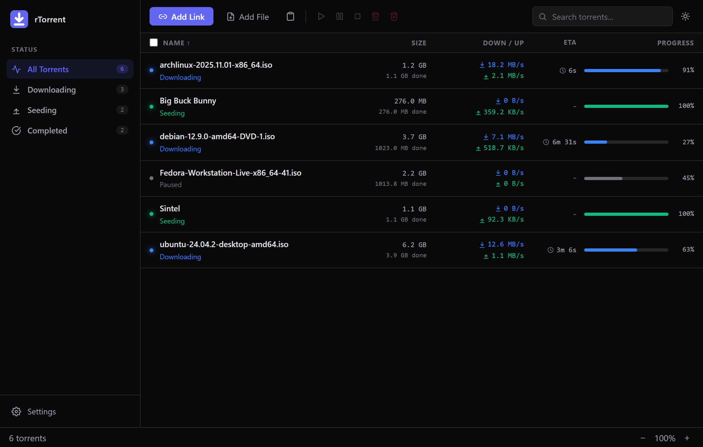
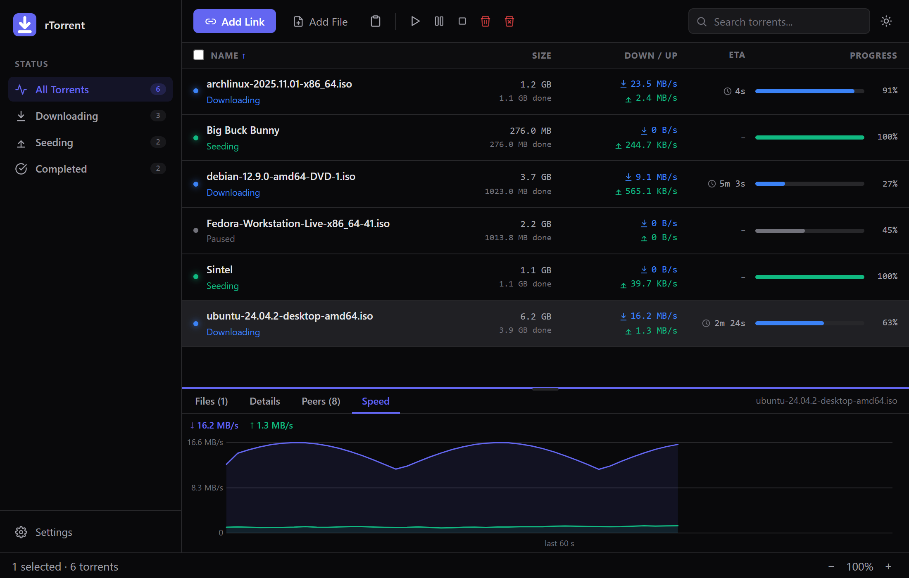
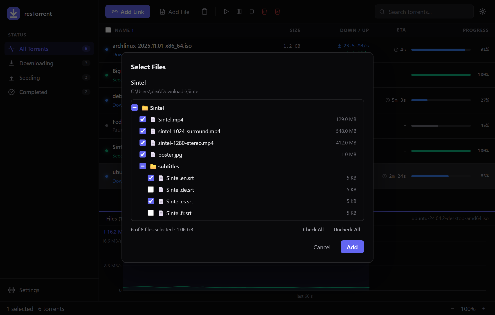
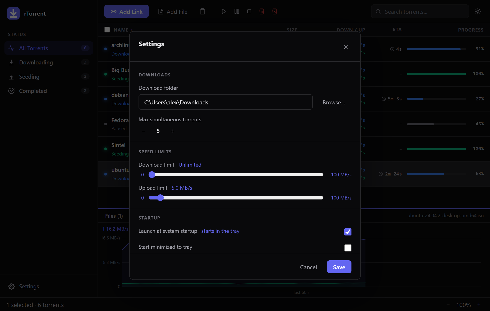
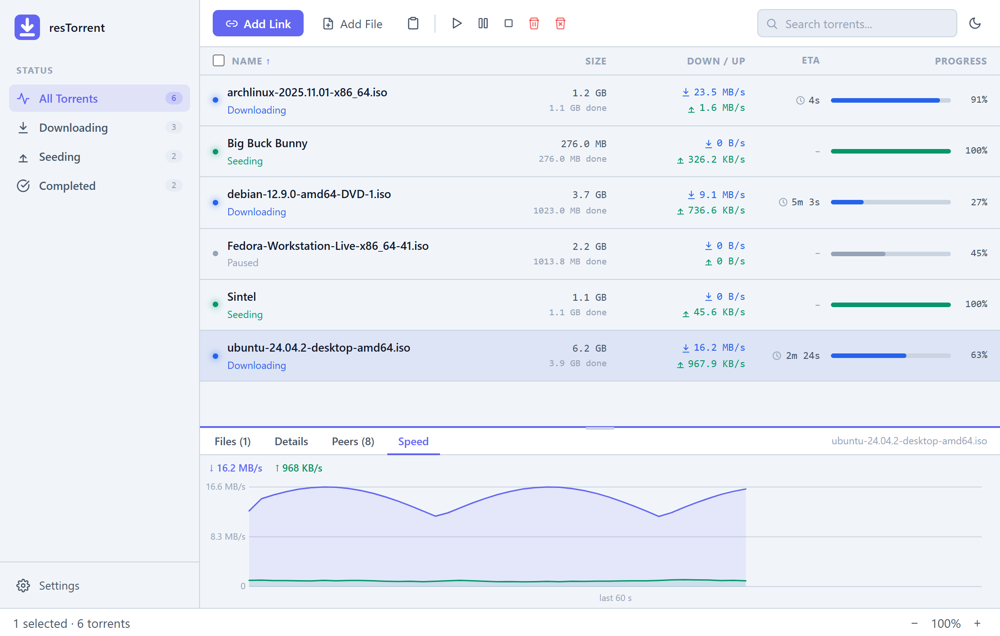

# resTorrent

A lightweight, cross-platform BitTorrent client built with **Rust + Tauri 2** and a **SolidJS** frontend. Website: <https://restorrent.reslab.pro>

[](https://github.com/andrewchuev/restorrent/releases/latest)

---

## Features

- **Magnet links & .torrent files** — add torrents by URL, file picker, drag & drop, or paste from clipboard (`Ctrl+V` global shortcut); installed builds also register as a handler for `.torrent` files, so opening one in Explorer adds it to the running app
- **Choose what to download** — every add resolves the torrent's metadata first and shows a file/folder tree so you can pick exactly what to grab, with per-folder toggling and Check All / Uncheck All
- **No duplicates** — adding a torrent that is already in the list (by `.torrent` file or magnet link) skips the file dialog, selects the existing entry and shows a notice
- **Real-time stats** — download/upload speed, progress, and peer count updated every second, with a live speed chart
- **Resizable detail panel** — drag to resize, per-file progress bars, active peer list, and the speed chart for the selected torrent
- **Multi-select** — Shift/Ctrl+click to select multiple torrents; bulk start/pause/stop/remove actions always available
- **System tray** — runs in the background; hide to tray on close, left-click the tray icon to show or hide the window (the tray menu has a matching Show/Hide Window item and Quit)
- **Download-complete notifications** — desktop notification when a torrent finishes
- **Settings** — configurable download folder, speed limits, and startup behavior (launch with the system, start minimized to the tray). App settings are persisted to TOML; the autostart entry itself lives in the OS (registry on Windows, launch agent on macOS, `.desktop` file on Linux)
- **Sort, zoom & theme** — sort by name, status, progress, speed or size; UI zoom via Ctrl +/−/0; dark/light theme toggle
- **DHT** — decentralised peer discovery, no tracker required for magnet links

---

## Screenshots

<p align="center">
  <picture>
    <source media="(prefers-color-scheme: light)" srcset="docs/screenshots/main-light.png">
    
  </picture>
</p>

| Live speed chart and details | Pick exactly what to download |
|:---:|:---:|
|  |  |

| Settings and startup options | Light theme |
|:---:|:---:|
|  |  |

*The screenshots use demo data: freely distributable Linux ISOs and Blender open movies.*

---

## Installation

Download the latest release for your platform from the [Releases](https://github.com/andrewchuev/restorrent/releases) page:

| Platform | File |
|----------|------|
| Windows  | `resTorrent_x.x.x_x64-setup.exe` or `.msi` |
| macOS    | `resTorrent_x.x.x_universal.dmg` (Intel + Apple Silicon) |
| Linux    | `resTorrent_x.x.x_amd64.AppImage` or `.deb` |

### Notes

- **macOS:** If you see *"unidentified developer"* — right-click the `.app` → **Open**.
- **Windows:** SmartScreen may warn about an unknown publisher — click **More info → Run anyway**.
- **Linux AppImage:** `chmod +x resTorrent_*.AppImage && ./resTorrent_*.AppImage`
- **Opening `.torrent` files (Windows):** the installer registers resTorrent as a handler, but Windows 11 keeps your current default. Once, right-click a `.torrent` → **Open with → Choose another app → resTorrent → Always**. If the app is already running (even in the tray), the file is passed to it instead of starting a second copy.

---

## Tech Stack

| Layer | Technology |
|-------|-----------|
| Desktop shell | [Tauri 2](https://tauri.app) |
| Backend / business logic | Rust (stable) |
| BitTorrent engine | [librqbit 9](https://github.com/ikatson/rqbit) |
| Frontend | [SolidJS](https://solidjs.com) + TypeScript |
| Frontend build | [Vite](https://vitejs.dev) |
| Config persistence | TOML (`~/.config/rtorrent/settings.toml`) |

---

## Building from Source

### Prerequisites

- [Rust](https://rustup.rs) stable toolchain
- [Node.js](https://nodejs.org) LTS
- Platform system libraries:

  **Ubuntu / Debian:**
  ```bash
  sudo apt-get install libwebkit2gtk-4.1-dev libayatana-appindicator3-dev librsvg2-dev patchelf
  ```

  **macOS:** Xcode Command Line Tools (`xcode-select --install`)

  **Windows:** [Visual Studio C++ Build Tools](https://visualstudio.microsoft.com/visual-cpp-build-tools/) + [WebView2](https://developer.microsoft.com/en-us/microsoft-edge/webview2/) (pre-installed on Windows 11)

### Run in development

```bash
git clone https://github.com/andrewchuev/restorrent.git
cd restorrent
npm install
npm run tauri dev
```

### Build release binary

```bash
npm run tauri build
```

Output is in `src-tauri/target/release/bundle/`.

---

## Release Process

Releases are built automatically by GitHub Actions for all three platforms whenever a version tag is pushed. Bump the version first in `package.json`, `src-tauri/Cargo.toml`, `src-tauri/Cargo.lock` and `src-tauri/tauri.conf.json`, commit, then:

```bash
git tag v1.0.0
git push origin main v1.0.0
```

The workflow publishes a GitHub Release with all platform installers attached. Running the workflow manually (`workflow_dispatch`) creates a draft by default instead.

---

## Project Structure

```
restorrent/
├── src/                        # SolidJS frontend
│   ├── App.tsx                 # Root component, layout, drag-drop, sorting, add-torrent pipeline
│   ├── lib/
│   │   ├── commands.ts         # Typed Tauri IPC wrappers
│   │   ├── theme.ts            # Dark/light theme persistence
│   │   └── format.ts           # Byte size / speed / ETA formatting helpers
│   └── components/
│       ├── Toolbar.tsx         # Add torrent, open file, paste link
│       ├── TorrentRow.tsx      # Single torrent list item
│       ├── DetailPanel.tsx     # Resizable panel: per-file progress, peers, speed chart
│       ├── FileSelectionDialog.tsx  # Pick files/folders before a torrent starts downloading
│       └── Settings.tsx        # Settings modal
└── src-tauri/                  # Rust backend
    └── src/
        ├── lib.rs              # App setup, single-instance handoff, tray, background stats emitter
        ├── engine/
        │   └── manager.rs      # TorrentManager wrapping librqbit Session
        ├── commands/
        │   ├── torrent.rs      # Tauri commands: list/confirm/cancel add, pause, resume, remove, details
        │   └── settings.rs     # Tauri commands: get/save settings + TOML I/O
        └── error.rs            # AppError with Tauri-serializable impl
```

---

## Roadmap

- [ ] Tracker list tab in detail panel
- [ ] Sequential download mode for streaming
- [ ] RSS feed / auto-download rules
- [ ] Code signing for Windows & macOS releases

---

## Contributing

Issues and pull requests are welcome. For significant changes please open an issue first to discuss the approach.

CI runs formatting, lint, and tests on every push/PR ([.github/workflows/ci.yml](.github/workflows/ci.yml)); the same checks locally:

```bash
# Frontend: type check
npx tsc --noEmit

# Rust: format, lint, test
cargo fmt --manifest-path src-tauri/Cargo.toml --check
cargo clippy --manifest-path src-tauri/Cargo.toml --all-targets -- -D warnings
cargo test --manifest-path src-tauri/Cargo.toml
```

---

## License

MIT — see [LICENSE](LICENSE) for details.
